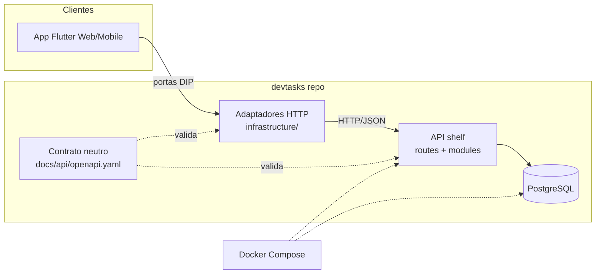

# DevTasks — Design & Contratos Visuais + Decisões de Engenharia (DESIGN.md)

> **Status**: `Rascunho` | **Versão**: `1.0.0` | **Data**: `2026-10-21`
> **Autor (PO/Arquiteto)**: Denerson Nobre
> **Localização canônica**: `docs/architecture/DESIGN.md`
> **Governança**: `PRD.md` define **O QUE** (escopo/aprovação do PO) · `SPEC.md` define o **DOMÍNIO** (invariantes/portas) · **este documento** define **COMO** — decisões de engenharia, contratos técnicos e contratos visuais.
> **Fonte visual**: `docs/product/Designer.png` (wireframe do PO, 1024×1536) — as cores marcadas `[medido]` foram extraídas por amostragem de pixels deste arquivo; as marcadas `[estimado]` são avaliação visual (confiança Média) e podem ser ajustadas na revisão.

---

## 1. Princípios de Design & Identidade

- **Tom & Filofosia**: SaaS leve e acolhedor — *light-first*, minimalista, cards brancos sobre fundo quase-branco, cantos generosos e sombras sutis. Sem densidade corporativa (posição anti-Jira).
- **Arquitetura Visual**: identidade ancorada em **roxo vibrante** (marca, CTAs, elemento ativo) contrastado com **navy escuro** (cabeçalhos de módulo, texto forte). Ilustração flat de pessoas no topo reforça o tom colaborativo.
- **Marca**: quadrado arredondado roxo com *check* branco (logo `DevTasks`, wordmark em navy) + assinatura *"Do backlog a grandes conquistas."*
- **Princípio de conteúdo**: toda tela é orientada a **cartão**; ação primária sempre roxa e visível sem rolagem.

---

## 2. Design Tokens Canônicos

### 2.1 Paleta Semântica

| Token | Hex | Origem/Confiança | Uso pretendido | Contraste |
| :--- | :--- | :--- | :--- | :---: |
| `color-primary` | `#8575F8` | `[medido]` faixa #8068E8–#8878F8 | Botões primários, links ativos, logo, elemento ativo | 4.5:1 sobre branco* |
| `color-primary-deep` | `#7058D0` | `[medido]` | Hover/pressed/foco do primário | — |
| `color-primary-soft` | `#EEEBFF` | `[estimado]` | Backgrounds sutis de badge/área ativa | — |
| `color-navy` | `#283848` | `[medido]` (n=10001) | Cabeçalhos de módulo, títulos fortes, dark surface | — |
| `color-text-main` | `#1A2433` | `[medido]` (faixa #102030–#182838) | Texto primário | 7:1 |
| `color-text-muted` | `#6B7280` | `[estimado]` | Rótulos, legendas, metadados | 4.5:1 |
| `color-background` | `#FAFAFB` | `[medido]` | Fundo da aplicação | — |
| `color-surface` | `#FFFFFF` | `[medido]` | Cards, modais, painéis | — |
| `color-border` | `#E3E4E8` | `[medido]` (faixa #D0D0E0–#E0E0E0) | Divisores, contornos de card/inputs | — |
| `color-success` | `#2FA36B` | `[estimado]` | Concluído, validação positiva, "Em andamento" (pill) | — |
| `color-error` | `#E5484D` | `[estimado]` | Erros, ações destrutivas, prioridade Alta, atrasadas | — |
| `color-warning` | `#E5A100` | `[estimado]` | Prioridade Média, avisos | — |
| `color-info` | `#3B82F6` | `[estimado]` | Contador "Em andamento" no dashboard, badge Baixa | — |

\* `#8575F8` sobre branco ≈ 3.4:1 — **uso permitido para grandes elementos/botões com texto branco (3:1)**; para texto pequeno roxo sobre branco usar `color-primary-deep` (≈ 4.6:1). Validação final por ferramenta de contraste na EPIC-00.

### 2.2 Marca & Ícones

- **Logo**: quadrado `color-primary`, raio 22%, ícone `check` branco — presente em Login/Cadastro e cabeçalho.
- **Set de ícones**: Material Symbols (Flutter `Icons.*`) — o wireframe usa ícones sólidos geométricos (pasta, gráfico, quadro, engrenagem).

### 2.3 Tipografia

- **Família primária**: `Inter` (avaliação visual do wireframe sugere geométrica similar a Poppins/Inter — decisão: **Inter** por disponibilidade Flutter/Web e legibilidade em dados). Fallback: `system-ui`.
- **Escala**: `Display 32/40` · `H1 24/32` · `H2 20/28` · `Body 14/20` · `Caption 12/16` (títulos de módulo do wireframe usam ~16/700 nos cabeçalhos navy).

### 2.4 Espaçamentos, Raios e Sombras (grid de 4px)

- `space-1..8`: 4 · 8 · 12 · 16 · 24 · 32 px.
- **Raio**: `r-sm 8px` (badges/inputs) · `r-md 12px` (cards) · `r-lg 16px` (modais/colunas) · `r-full` (pills, avatares).
- **Sombra**: `elev1 0 1 3 rgba(26,36,51,.08)` (cards) · `elev2 0 4 16 rgba(26,36,51,.12)` (modais/drag).

---

## 3. Estados Canônicos de Interface (obrigatórios em toda tela)

1. **Loading**: skeleton com a geometria do elemento final (cards/linhas) — sem spinner vazio.
2. **Vazio**: mensagem + CTA (*"Nenhum projeto ainda. Crie o primeiro →"*).
3. **Erro**: mensagem sem jargão de backend + botão **Retry** inline.
4. **Dados**: conteúdo completo + microinterações (drag feedback, pill de status com transição).

---

## 4. Contratos de Componentes Críticos

### 4.1 Botão
- **Primário**: fundo `color-primary`, texto branco, raio 8, altura 40 (desktop) / 44 (touch); foco `outline 2px color-primary-deep`.
- **Secundário**: fundo transparente, borda `color-border`, texto `color-text-main`.
- **Destrutivo**: texto/fundo `color-error` — exige diálogo de confirmação (ex.: *Excluir workspace*).

### 4.2 Entradas (`Input`, `Select`)
- Repouso: borda `color-border`; foco: borda `color-primary`; erro: borda `color-error` + mensagem inline abaixo (12px).

### 4.3 Card de Tarefa (Kanban)
- `color-surface`, raio 12, elev1. Conteúdo: **título (14/600)** → **badge de prioridade** → rodapé: avatar do responsável + data limite + contadores (comentários, checklist). Estados: `is-dragging` (elev2 + opacidade 0.9), `is-overdue` (borda/ícone `color-error` na data).

### 4.4 Coluna Kanban
- Header: contêiner `color-surface` com título + contagem ex. `Backlog (5)`; ação `+ Adicionar tarefa` no rodapé da coluna. *(Conjunto fixo de **3 colunas**: `Backlog | Em Progresso | Concluído` — D-01 decidida.)*

### 4.5 Badge de Prioridade
- **Alta** = `color-error` · **Média** = `color-warning` · **Baixa** = `color-info` · pill (raio full), 11/600, fundo pastel do próprio tom a 12% + texto sólido.

### 4.6 StatCard (Dashboard/Relatórios)
- Círculo 32px com ícone (roxo/verde/azul/vermelho) + número (24/700) + rótulo (12, muted). 4 por linha no desktop, 2×2 no mobile.

### 4.7 AvatarStack
- Avatares 28px sobrepostos −8px; excedente `+N` em pill `color-navy`.

### 4.8 Shell de Navegação (implícito no wireframe — decisão de design)
- **Desktop (>1024)**: sidebar fixa `color-navy` com 10 itens do wireframe (Dashboard, Workspaces, Projetos, Board, Tarefas, Comentários, Membros, Relatórios, Configurações) + topo com logo/busca.
- **Tablet**: sidebar reduzida a ícones.
- **Mobile (<768)**: drawer + barra inferior com 4 destinos (Dashboard, Projetos, Board, Perfil).

---

## 5. Responsividade & Acessibilidade

- **Breakpoints**: `Mobile < 768` · `Tablet 768–1024` · `Desktop > 1024` (largura lógica Flutter).
- **WCAG AA**: contraste 4.5:1 texto / 3:1 grandes; navegação por teclado completa (web); `Semantics` widgets com rótulos explícitos nos elementos interativos; alvos de toque ≥ 44px; drag-and-drop **sempre** com alternativa (menu de mover card → coluna) para teclado/leitor de tela.

---

## 6. Temas Claro/Escuro (RNF-07)

- O wireframe define seletor **Tema: Automático | Claro | Escuro** → mapear para `ThemeMode.system | light | dark`.
- Todos os tokens §2.1 são semânticos e duplicáveis por tema; **paridade obrigatória**: nenhuma tela existe só no claro. Tema escuro: `background #0F141B`, `surface #1A212C`, `navy→ #232E3D`, primário inalterado, texto `#E6EAF0`.
- Persistência da preferência local (arquivo de perfil futuramente).

---

## 7. Arquitetura de Estilos — BEMIT/OOCSS adaptado à plataforma

> Conflito de template: `design_template.md` §6 especifica BEMIT/OOCSS (CSS). A plataforma é **Flutter** — regra do oráculo: *a plataforma tem precedência*. Adaptação registrada (não silenciosa):

| Princípio ITCSS/BEMIT | Equivalente Flutter adotado |
|---|---|
| Settings (tokens) | `lib/global/theme/tokens.dart` (constantes) + `ColorScheme`/`TextTheme` |
| Objects (`o-`) | Widgets estruturais sem skin: `AppCard`, `AppPage`, `AppGap` |
| Components (`c-`) | Widgets funcionais: `TaskCard`, `PriorityBadge`, `StatCard`, `PrimaryButton` |
| Utilities (`u-`) | Extensions/`AppSpacing` helper |
| States (`is-`/`has-`) | Parâmetros/enum do widget (`TaskCardState.dragging`) |
| OOCSS estrutura×pele | Widget compõe layout; cor/elevação chegam só via tema |
| OOCSS container×conteúdo | Componente nunca referencia ancestral (sem `findAncestor` de estilo) |

---

## 8. Decisões de Engenharia (D-ENG)

- **D-ENG-01 — Stack** ⚠️ **SUPERADA pela D-08**: Flutter Web/Mobile + Serverpod + PostgreSQL + Docker. O Serverpod foi abandonado em 2026-10-24 (ver §14); stack alvo = Flutter + **shelf** + PostgreSQL + Docker.
- **D-ENG-02 — Monorepo**: pub workspace nativo na raiz com membros `solution/{app,api}` (skill `flutter-pub-workspace`); lock único na raiz. (`server`/`client` existem só até o UC-08.08.)
- **D-ENG-03 — Contrato** ⚠️ **SUPERADA pela D-08**: `serverpod generate` era a fonte de verdade. Motivo da reversão: o pacote `client` era derivado do **código do servidor**, acoplando o cliente à tecnologia do backend. Nova fonte: `docs/api/openapi.yaml` (OpenAPI 3.1).
- **D-ENG-04 — Auth** ⚠️ **SUPERADA pela D-08**: o módulo `serverpod_auth_server` deixa de ser usado. Auth própria em shelf: Argon2 (pointycastle) + token opaco com hash SHA-256 em `devtasks_session` + rate limit por IP.
- **D-ENG-05 — Isolamento multi-tenant**: toda mutação/leitura de endpoint valida membership (RF-06) — a invariante formal (`INV-XX`) nasce na `SPEC.md`.
- **D-ENG-06 — Estrutura do app (VSA)**: `solution/app/lib/modules/<modulo>/{domain,infrastructure,presentation}` + kernel `global/` (theme, router, shared widgets). Backend: `solution/api/lib/src/http/routes/` + `lib/src/modules/` (VSA no servidor).
- **D-ENG-07 — Estado no app**: **Riverpod** — decidido (**D-03**, 2026-10-21): testabilidade e padrão de mercado transferível para portfólio; alternativa GetX (skill existente do autor) descartada.
- **D-ENG-08 — Ambientes & Docker**: compose local (`devtasks_postgres`, `devtasks_server`, rede `devtasks_net`, binding `0.0.0.0` p/ testes LAN — convenção anti-colisão do oráculo); deploy alvo Railway/Render + Flutter Web estático (PRD roadmap Fase 8).
- **D-ENG-09 — Testes**: pirâmide do oráculo — unit de domínio com fakes (invariantes 100%), contract no client/server, poucos E2E; runner único de comando (EPIC-00).

---

## 9. C4 — Contêineres & Topologia do Repositório

> **Alvo após o EPIC-08** (`D-08`). Durante a migração, `server/` e `client/` coexistem congelados
> até o `UC-08.08`.



```text
devtasks/
├── pubspec.yaml            # workspace raiz (app, api)
├── docs/{product,architecture,plan,api}/   # api/openapi.yaml = contrato
├── docker/
├── solution/
│   ├── app/                # Flutter (VSA: lib/modules/* + global/)
│   └── api/                # shelf: bin/, lib/src/{http,db,modules}, migrations/, test/
└── tools/                  # db.ps1, contract-gate.ps1, dip-gate.ps1, test.ps1
```

---

## 10. Telas ↔ Rotas (mapa do wireframe)

| Módulo (wireframe) | Telas | Rota proposta |
|---|---|---|
| Autenticação | Login, Cadastro, Recuperar senha*, Convite* | `/login`, `/register` |
| Dashboard | Principal (saudação, 4 Stats, progresso, atividades†, meus projetos) | `/` |
| Workspaces | Lista, Criar, Membros | `/workspaces`, `/workspaces/:id` |
| Projetos | Lista, Detalhes (abas: visão geral, tarefas, membros, config) | `/projects/:id` |
| Kanban Board | Board principal (busca†), Card de tarefa | `/board/:projectId` |
| Tarefas | Criar, Detalhes (labels†, anexos†, subtarefas†, histórico†) | `/tasks/:id` |
| Comentários | Feed, histórico | seção de `/tasks/:id` |
| Membros | Lista, Convite (e-mail + função), Permissões | `/members` |
| Relatórios† | Visão geral, desempenho, por membro, donut | `/reports` |
| Configurações | Perfil, Workspace, Preferências (tema, notificações†, idioma†) | `/settings/*` |

\* foras do MVP (PRD §5.6) · † divergência de escopo — ver §12.

---

## 11. Divergências Wireframe × PRD (registro obrigatório — PRD é fonte de escopo)

O wireframe é **mais rico que o MVP aprovado**. Recomendação padrão: **PRD governa escopo**; itens marcados ↗ merecem consideração do PO por serem baratos.

| # | Item no wireframe | No PRD | Recomendação |
|---|---|---|---|
| W-01 | Colunas: `Backlog / Em Progresso / Concluído` (**3**) | RF-10 v1: `Backlog/To Do/In Progress/Done` (**4**) | ✅ **D-01 decidida → wireframe**; PRD RF-10 corrigido (2026-10-21) |
| W-02 | Papéis: Owner/Developer/Viewer (3) + seletor de função no convite | §7 v1: owner/member (2) | ✅ **D-02 decidida → wireframe**; PRD §7/RF-05/§9 corrigidos (2026-10-21) |
| W-03 | Convite por link ("Aceitar/Recusar") + "Enviar convite" | Adição de membro existente (§5.6) | Manter PRD; convite por link pós-MVP |
| W-04 | Recuperar senha | §5.6 fora | Fora; é pré-requisito pós-demo |
| W-05 | Relatórios completos (desempenho, por membro, donut) | Relatórios avançados fora (§5.3) | Dashboard RF-13 é o escopo; `/reports` pós-MVP |
| W-06 | Labels, Anexos(0), Subtarefas(0), Histórico na tarefa | Subtarefas/anexos fora (§5.3) | Ocultar os contadores no MVP (não exibir feature morta) |
| W-07 | Notificações e-mail/push/som nas preferências | Push fora (§5.1) | Ocultar toggles no MVP |
| W-08 | Idioma (Português) | Multi-idioma fora (§5.8) | Fixar pt-BR, sem seletor |
| W-09 | "Excluir workspace" | RF-04 sem exclusão | ↗ Incluir (Owner + confirmação) — barato e esperado de CRUD |
| W-10 | "Assinatura" no menu do workspace | Inexistente | Fora — não há billing no produto; remover do menu |
| W-11 | Busca no board, "Atividades Recentes", alterar foto, adicionar logo | Inexistentes | Busca+logo ↗ baratos (pós-MVP se o PO não aceitar agora); atividades/audit → pós-MVP |
| W-12 | Tema "Automático" | RNF-07 claro/escuro | ✅ compatível (`ThemeMode.system`) |

---

## 12. Decisões (D-01/D-02/D-03 fechadas em 2026-10-21 pelo PO)

| # | Questão | Decisão | Efeito aplicado |
|---|---|---|---|
| **D-01** | Colunas do Kanban (W-01) | **3 colunas**: `Backlog → Em Progresso → Concluído` (seguir o wireframe) | PRD RF-10 + Apêndice A (C4) + modelo §9 (`status: backlog\|in_progress\|done`) corrigidos |
| **D-02** | Papéis (W-02) | **3 papéis**: Owner / Developer / Viewer (seguir o wireframe) | PRD RF-05, matriz §7 e modelo §9 (`role: owner\|developer\|viewer`) corrigidos; SPEC modelará enum de 3 valores |
| **D-03** | Estado no app (D-ENG-07) | **Riverpod** | D-ENG-07 atualizado — GetX descartado |
| **D-04** | Branches & Ciclo | Commits de UC em **`develop`** com claim ativo; `main` só release consolidada | Hook commit-msg bloqueia violações mecânicas (2026-10-21) |
| **D-05** | Runner do Gitea Actions | **Adiado para janela dedicada de DevOps** | GitHub Actions garante oráculo verde de testes, lint e Docker build; runner Gitea será provisionado quando houver suporte a containers |
| **D-06** | Tema Base & WCAG (NC-17) | **Reatribuído da EPIC-00 para a EPIC-01** | RNF-05/06/07 vinculados ao Design System e telas de autenticação, onde há UI real para validação de contraste e tema |
| **D-07** | Padrão de apresentação (app) | **MVVM por slice, unidirecional**: 1 caso de uso = 1 ViewModel com **estado imutável** + **intents**; View renderiza e despacha; Model = VOs/handlers/portas | Riverpod é o **mecanismo** (D-03), não a arquitetura. Estado transversal (sessão/tema) em `global/` — slice **observa**, nunca duplica. VM sem `BuildContext`/I/O; **código enxuto** com Object Calisthenics, SOLID e Clean Code **ponta a ponta**, verificados no Gate 3 (2026-10-23) |

> Registradas aqui com data e efeito aplicado — nada foi mudado silenciosamente nos documentos.

### 12.1 Regras de execução da D-07 (vinculantes para o app)

1. **1 slice = 1 ViewModel** (por caso de uso): `presentation/<slice>/<slice>_view_model.dart` +
   `<slice>_view.dart` + `<slice>_state.dart`. Proibido ViewModel "de módulo" acumulando fatias.
2. **Estado imutável + intents**: `LoginState` (campos `final`) e métodos-intenção (`submit()`, `retry()`).
   Nada de campo público mutável, nada de *two-way binding* (não existe em Flutter; emular cria loop).
3. **VM puro**: sem `BuildContext`, sem I/O — portas injetadas (Riverpod `Provider`/`Notifier`).
   I/O e mapeamento vivem em `infrastructure/` e no domínio.
4. **Transversal só em `global/`** (sessão, tema, config); o VM do slice **observa** o estado global.
5. **Qualidade de código (DoD do slice)**: um nível de indentação por método, sem `else` de validação,
   sem números/strings mágicos, VOs para primitivos de negócio, sem comentário-ruído, arquivos pequenos;
   o **Gate 3** audita explicitamente Calisthenics + SOLID + Clean Code no diff.
6. **Testes**: unit do ViewModel com fakes (base da pirâmide) ≫ widget test (renderização/eventos).

---

## 13. Critérios de aceite deste documento

- [ ] Tokens §2.1 revisados (hex `[estimado]` confirmados/ajustados pelo PO)
- [x] D-01, D-02, D-03 decididos (2026-10-21) → PRD e DESIGN ajustados; SPEC nasce já coerente com as decisões
- [ ] Tabela §11 com aceite/rejeção por linha (o que vira pós-MVP no plano)
- [x] Validação de contraste (WCAG) reatribuída para a EPIC-01 (D-06)
- [x] **D-08** registrada (2026-10-24): migração Serverpod → shelf + contrato neutro OpenAPI

---

## 14. D-08 — Migração Serverpod → shelf + contrato neutro (2026-10-24)

**Decisão do PO**: abandonar o Serverpod e reescrever o servidor em **shelf**, com **PostgreSQL via
SQL puro** e **OpenAPI 3.1 como fonte de verdade do contrato**.

**Motivo (arquitetural, não técnico)**: o pacote `solution/client/` era **gerado a partir do código do
servidor**, então o cliente dependia da tecnologia do backend. O desacoplamento não vem da troca de
framework — vem do **contrato neutro + adaptador**. Por isso o contrato (`docs/api/openapi.yaml`) é
gate bloqueante (`UC-08.06`), com prova negativa versionada.

**Escolhas e alternativas descartadas:**

| Tema | Escolha | Alternativa descartada | Por quê |
|:--|:--|:--|:--|
| HTTP | `shelf` + `shelf_router` | `dart_frog` | shelf é o mínimo oficial; dart_frog é outro framework opinativo (novo acoplamento) |
| Dados | `postgres` + SQL puro + migrations `.sql` | `drift` / ORM | SQL explícito, sem codegen; DIP preservado pelas portas |
| Contrato | OpenAPI 3.1 + teste de contrato | geração a partir do código | geração a partir do código **é** o defeito original |
| Dados existentes | recriar schema (demo) | migrar dados | não há Postgres em uso; sem dado real a preservar |

**Custo assumido (medido, não estimado)**: 14 arq / 891 LOC portáveis sem mudança; 12 arq / ~840 LOC
com troca de DTO; 7 arq / ~650 LOC reescritos; 21 arq / 2.541 LOC de teste (unit com fakes sobrevive).
Fatiado em 8 UCs em `docs/plan/epics/epic-08-migracao-shelf.md`.

**Consequências vinculantes:**

1. `solution/server/` e `solution/client/` ficam **congelados** (sem features novas) e são removidos no `UC-08.08`.
2. Nenhum identificador de transporte (`devtasks_client`, `serverpod`) pode aparecer em `domain/` ou `presentation/`;
   o `dip-gate` passa a proibi-los e a varrer `presentation/`.
3. `AGENTS.md` (Stack/Topologia/Contrato) atualizado no mesmo commit desta decisão.
4. `RNF-03` mantém **token opaco** (não JWT): decisão anterior preservada, agora com implementação própria.
5. **IDs são UUID** (`uuid` no Postgres, `String` no Dart) em todas as entidades e no schema. Motivo:
   o contrato já declara `format: uuid` (11 pontos) e identificador sequencial em API pública permite
   enumeração. Consequência de teste: identificadores nunca são `int`; `createdAt` é **obrigatório**
   onde o contrato o exige (`required: [id, name, role, createdAt]`).

**Não-objetivo declarado**: melhorar performance ou reduzir custo de infra. A migração é por
integridade arquitetural; se o resultado não produzir um cliente testável sem o pacote do servidor,
o épico **falhou**, mesmo que os testes estejam verdes.
