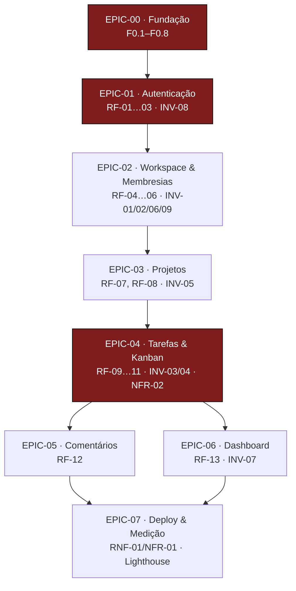

# Plan — DevTasks

> Índice central de planejamento e roteiro de evolução do projeto.
> Fonte de escopo: `docs/product/PRD.md` · Domínio/invariantes: `docs/architecture/SPEC.md` ·
> Engenharia/UI: `docs/architecture/DESIGN.md`.
> Anatomia canônica: `~/.agents/templates/backlog_template.md` (paridade DAG ➜ arquivo 1:1, sem placeholder).

---

## 1. Relação de Épicos Fatiados

| Épico | Arquivo | Dependências | Prioridade | Status |
|:---|:---|:---|:---:|:---:|
| **00 — Fundação** | [epic-00-fundacao.md](epics/epic-00-fundacao.md) | Nenhuma (independência máxima) | Crítica | ⏳ Pendente |
| **01 — Autenticação** | [epic-01-autenticacao.md](epics/epic-01-autenticacao.md) | EPIC-00 | Crítica | ⏳ Pendente |
| **02 — Workspace & Membresias** | [epic-02-workspace.md](epics/epic-02-workspace.md) | EPIC-00, EPIC-01 | Alta | ⏳ Pendente |
| **03 — Projetos** | [epic-03-projetos.md](epics/epic-03-projetos.md) | EPIC-02 | Alta | ⏳ Pendente |
| **04 — Tarefas & Kanban** | [epic-04-tarefas-kanban.md](epics/epic-04-tarefas-kanban.md) | EPIC-03 | Crítica | ⏳ Pendente |
| **05 — Comentários** | [epic-05-comentarios.md](epics/epic-05-comentarios.md) | EPIC-04 | Média | ⏳ Pendente |
| **06 — Dashboard** | [epic-06-dashboard.md](epics/epic-06-dashboard.md) | EPIC-04 | Alta | ⏳ Pendente |
| **07 — Deploy & Medição** | [epic-07-deploy.md](epics/epic-07-deploy.md) | EPIC-00, EPIC-06 | Alta | ⏳ Pendente |

> **Gate de DAG (hard)**: o runner da EPIC-00 parseia este arquivo e falha se (a) um épico estiver ✅ com pré-requisito aberto ou (b) qualquer nó da DAG não tiver arquivo correspondente no disco. Documento é soft-compliance; exit code é o enforcement.

---

## 2. DAG de Precedência (Mermaid)

- **Regra 1 (inviolável)**: precedência topológica — nenhum épico inicia com pré-requisito aberto.
- **Regra 2 (desempate)**: Risk-First / Core-First — EPIC-01 (auth, superfície sensível, Gate 2.5) e EPIC-04 (core Kanban, INV-04/NFR-02) são as de maior risco técnico; EPIC-05 e EPIC-06 correm em paralelo após EPIC-04 (ramos disjuntos).

---

## 3. Ordem Canônica de Execução

1. **EPIC-00 (Fundação)** — impreterivelmente primeira; só encerra com artefato verificável por comando (build 1-comando, suíte verde, hooks, gate de DAG).
2. **EPIC-01 ➜ 02 ➜ 03 ➜ 04** — cadeia funcional estrita (identidade ➜ tenancy ➜ projetos ➜ core).
3. **EPIC-05 ∥ EPIC-06** — após EPIC-04, ramos independentes.
4. **EPIC-07 (Deploy)** — fecha com a demo viva + medição de P95.

> Regra de ouro: **nenhuma fase de negócio inicia antes da EPIC-00 verde** (checkpoint do oráculo).

---

## 4. DoR & DoD Globais

### DoR (Definition of Ready) — pré-condições de todo UC

- [ ] Épico pré-requisito com DoD cumprido (gate de DAG verde).
- [ ] `git status --porcelain` limpo e baseline de build+testes verdes (pré-flight por UC).
- [ ] Claim atômico do slice obtido (`tools/bin/claims claim -slice <UC> ...`); conflito = aborte.
- [ ] User Story com persona e valor definidos; cenários Gherkin no épico.
- [ ] Portas/contratos do slice definidos na SPEC (ou a SPEC atualizada no mesmo ciclo).
- [ ] UC toca superfície sensível (auth, upload, webhook, CORS, shell, PII, dependência nova) ⇒ **Gate 2.5 (`security`) invocado e resultado registrado no hand-off**.

### DoD (Definition of Done) — condições inegociáveis de conclusão

- [ ] TDD **Red-Before-Green** comprovado (estado Red documentado antes do Green).
- [ ] Código aderente a VSA+DDD+Portas (DIP/ISP), Object Calisthenics e SOLID.
- [ ] Build e suíte de testes **100% verdes** (unit ≫ contract ≫ poucos E2E); `flutter analyze` sem warnings.
- [ ] 100% das `INV-XX` do escopo do UC com teste automatizado (NFR-04).
- [ ] Docs (`docs/plan/`, `LEARNINGS.md`) atualizados **no mesmo commit** da mudança.
- [ ] Commit Conventional atômico, stage **por path explícito**, com assinatura `(UC-XX.YY)`.
- [ ] Gates passaram: Gate 3 (`/review`, confiança Alta/Média) e Gate 4 (`/qa`, laudo).
- [ ] `claims release -slice <UC>` executado após o commit.

---

## 5. Convenções

- **Nomenclature**: UC no formato `UC-XX.YY` (XX = nº do épico); US `US-X.Y.Z`; tasks `TASK-NN` por UC.
- **Commits**: Conventional Commits atômicos — um UC = um commit (código + testes + docs).
- **Hand-off**: consolidação por UC em `docs/plan/state/UC-CURRENT.md`; laudos em `docs/plan/reviews/`.
- **Claims**: estado vivo fora do repo (`<git-common-dir>/claims/`); schema versionado em `docs/plan/state/claims.schema.json` (criado na EPIC-00).
- **Papéis de execução**: ciclo Coder ➔ Gate 3 (`review`) ➔ Gate 4 (`qa`) ➔ consolidação — `workflow_rules.md`.
- **Idioma**: identificadores em inglês; documentação (`docs/`, `LEARNINGS.md`) em pt-BR.

---

## 6. Matriz de Rastreabilidade (RF/INV/NFR ➜ Épico)

| Requisito | Invariante / NFR | Épico |
|---|---|---|
| RF-01, RF-02, RF-03 | INV-08 · NFR-03, NFR-05 | EPIC-01 |
| RF-04, RF-05, RF-06 | INV-01, INV-02, INV-06, INV-09 · RNF-02 | EPIC-02 (+ todos os subsequentes) |
| RF-07, RF-08 | INV-05 | EPIC-03 |
| RF-09, RF-10, RF-11 | INV-03, INV-04 · NFR-02 | EPIC-04 |
| RF-12 | INV-02, INV-05, INV-06 | EPIC-05 |
| RF-13 | INV-07 | EPIC-06 |
| RNF-01 (P95 < 500 ms) | NFR-01 | EPIC-07 |
| RNF-05, RNF-06, RNF-07 | NFR-03, NFR-04 | EPIC-00 (harness/tema base) + todos |

> Contrato de aceitação da QA: **100% das `INV-01…09` com teste automatizado** (SPEC §8).

---

## 7. Matriz de Status

| Épico | UCs | UCs concluídos | Status |
|:---|:---:|:---:|:---:|
| 00 — Fundação | 8 | 0/8 | ⏳ |
| 01 — Autenticação | 4 | 0/4 | ⏳ |
| 02 — Workspace & Membresias | 3 | 0/3 | ⏳ |
| 03 — Projetos | 2 | 0/2 | ⏳ |
| 04 — Tarefas & Kanban | 3 | 0/3 | ⏳ |
| 05 — Comentários | 2 | 0/2 | ⏳ |
| 06 — Dashboard | 1 | 0/1 | ⏳ |
| 07 — Deploy & Medição | 3 | 0/3 | ⏳ |
| **Total** | **26** | **0/26** | ⏳ |
